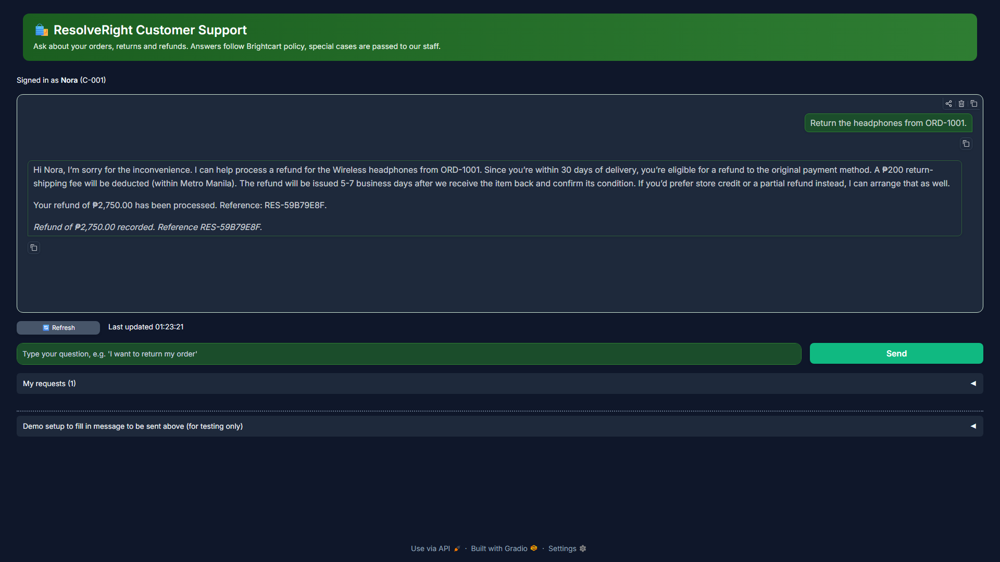
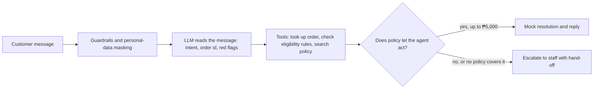
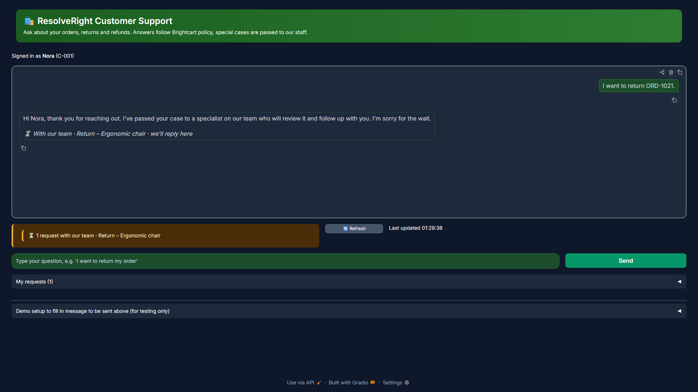
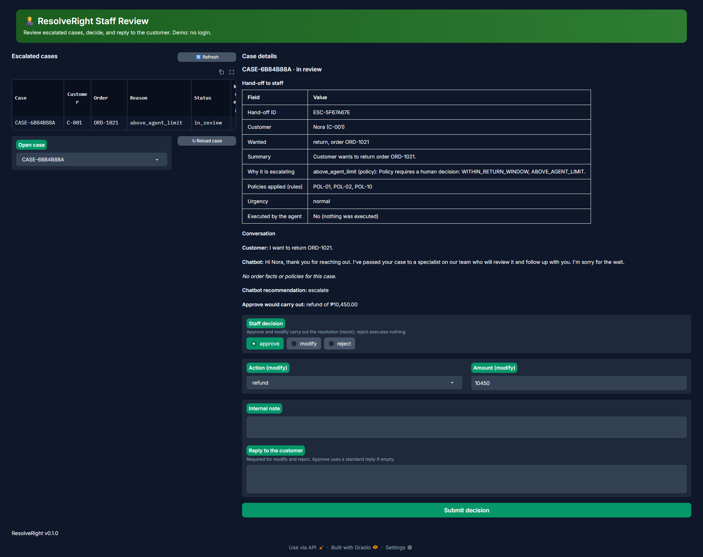

# ResolveRight Customer Support Chatbot

**An AI support chatbot that decides returns and refunds with tested rules, not guesses.**

  

[**Live demo**](https://resolveright.onrender.com/ui) · [Demo video (4:55, recorded on the live app)](docs/ResolveRight_demo_render.mp4) · [Local-build recording](docs/ResolveRight_demo_local.mp4) · [API docs](https://resolveright.onrender.com/docs) · [Architecture](docs/architecture.md) · [Evaluation](docs/evaluation.md)



ResolveRight answers return and refund requests for **Brightcart**, a fictional online store. A rules engine makes every decision. The language model only reads the customer's message and writes the reply. This is an individual capstone project for the PSIA AI Engineering course (Cohort #1). All data is synthetic: no real people, companies or payments.

> **Reviewing this capstone?** Try the [live demo](https://resolveright.onrender.com/ui) (about 3 minutes), then read [`docs/requirements-traceability.md`](docs/requirements-traceability.md) for the course tools used, [`docs/evaluation.md`](docs/evaluation.md) for results and [`docs/limitations.md`](docs/limitations.md) for what it does not do.
> The app runs on the Render free plan, so the first request after a quiet period can take about a minute.

## Contents

[What it does](#what-it-does) · [How it works](#how-it-works) · [Quick start](#quick-start) · [Results](#results-at-a-glance) · [Reference](#reference) · [Repository map](#repository-map) · [Documents](#documents) · [Limitations](#limitations) · [Security](#security) · [Help and credits](#help-and-credits)

## What it does

A customer writes a return or refund request in the chat. ResolveRight finds the order, checks it against Brightcart's return and refund rules, finds the matching policy text and replies.

- **Within policy, it acts.** For a refund, store credit, replacement or cancellation up to the ₱5,000 agent limit, it carries out the resolution itself. This is a mock: it writes a line in `logs/resolutions.jsonl` and changes a runtime copy of the order, never the files in `data/`. There is no real payment system.
- **Outside policy, it hands over to a person.** The case is escalated to staff with a structured hand-off (who, what they wanted, why it escalates) and nothing is executed. Cases escalate when a policy says so (safety hazard, suspected fraud, legal threat, harassment, open chargeback, three refunds in 90 days, a request for a human, an amount above ₱5,000, a late damage claim, address-change fraud risk), when no policy covers the case, or after a technical failure (labelled as a system fallback).
- **It never executes an escalated case**, even if the request is within policy and every tool would allow it. Address changes are only answered, never executed, because the app never handles addresses.

**Why rules and not the language model?** An AI that guesses refund rules would sometimes be wrong. So the decision comes from plain, tested code (the eligibility engine), and the language model cannot override it.

### An example

A customer writes: *"Return the headphones from ORD-1001, I changed my mind."*

1. **Decision:** the order is checked against the 30-day return window, the product type and the order status.
2. **Why:** the chat shows the exact rule that applied, with the policy passage it came from.
3. **Reply:** polite wording for the customer.
4. **Outcome:** if the case is within policy, the mock refund is recorded and the reply ends with a confirmation reference. If it is an escalation, the customer sees an escalation message at once and the case is queued for staff.

## How it works



*Simplified view. The full diagram and request flow are in [`docs/architecture.md`](docs/architecture.md).*

| Capability | What that means | Technical name |
|---|---|---|
| Understands the message | Works out what the customer wants, which order, and any red flags | LLM with structured output (Pydantic) |
| Looks things up | Finds the order, checks the rules, searches the policies, executes or escalates | Tools `lookup_order`, `check_eligibility`, `search_policy`, `execute_resolution`, `escalate_to_human` (mock data, deterministic) |
| Decides with rules, not guesses | The result of the rules engine is final | Eligibility engine |
| Quotes the policy | Replies cite policy passages, and a citation must be a passage that was really retrieved | RAG with Qdrant |
| Plans in several steps | Understand, gather facts, decide, draft, hand over only when policy escalates (at most 6 steps, 30 seconds) | LangGraph state machine |
| Remembers and asks | Keeps the conversation and asks one clarifying question if the request is unclear | Session memory |
| Stays safe | Blocks attacks, masks personal data, limits how much one user can ask | Layered guardrails, rate limit, daily budget |
| Saves cost | Does not pay for the same answer twice | Exact cache (SQLite) and semantic cache (Qdrant) |
| Can be inspected | Logs with request ids and no personal data; optional step-by-step traces | JSON logs, Langfuse |

New to AI engineering? See the [glossary](#glossary) for terms such as RAG, embedding, guardrails and LLM-as-judge.

## Quick start

### What you need

| Need | Why | Where |
|---|---|---|
| Python 3.12 | The app is written in Python | [python.org](https://www.python.org/downloads/) |
| `uv` | Installs the exact library versions (used instead of `pip`) | [docs.astral.sh/uv](https://docs.astral.sh/uv/) |
| Git | To download the project | [git-scm.com](https://git-scm.com/) |
| An OpenAI API key | The LLM and embedding calls (billing must be set up) | [platform.openai.com/api-keys](https://platform.openai.com/api-keys) |
| Docker (optional) | Only to run the packaged container | [docker.com](https://www.docker.com/) |

Windows, macOS and Linux all work. **Cost:** the unit tests make no paid calls. Starting the app embeds the 10 policy files once (a few cents), and each question costs a fraction of a cent. Set a monthly spend limit in the OpenAI dashboard.

### Run it

```bash
git clone https://github.com/cabscablao/resolveright.git
cd resolveright
uv sync                                     # installs the app and its libraries
cp .env.example .env                        # Windows PowerShell: Copy-Item .env.example .env
# open .env and replace "your-openai-key-here" with your real key
uv run python -m scripts.generate_data      # creates the sample customers and orders in data/
uv run python -m scripts.seed_checks        # should print "seed_checks: OK"
uv run pytest -q                            # no paid calls; the summary should show no failures
uv run uvicorn app.server:app --port 8000   # starts the app (stop it with Ctrl+C)
```

**Never commit `.env`, paste it into a chat or screenshot it.** It is git-ignored. The first start is slower because the policies are embedded once.

When the server is running:

| Address | What you see |
|---|---|
| <http://127.0.0.1:8000/ui> | The customer chat. **Start here.** |
| <http://127.0.0.1:8000/ui-staff> | Staff review of escalated cases (no login, demo only) |
| <http://127.0.0.1:8000/ui-dev> | Developer debug view: what the agent did for a case (read-only) |
| <http://127.0.0.1:8000/docs> | Interactive API page (OpenAPI) |
| <http://127.0.0.1:8000/health> | App version, model, prompt version, cache state |

### Try it in three steps

1. Open `/ui`. The page always chats as **Nora (C-001)**. Send *"Return the headphones from ORD-1001."*
2. Read the decision, the reasons, the cited policy and the reply. The badge reads *Completed - resolved by Brightcart Assistant*.
3. To see an escalation, send *"I want to return the ergonomic chair on ORD-1021."* (above the agent limit). The badge reads *Escalated - waiting for staff*. Open `/ui-staff` in a second tab to finish the case as a staff member.

The full walkthrough (staff decisions, follow-up messages while a case waits, resetting the demo state) is in [Demo walkthrough](#demo-walkthrough).

### Call the API directly

```bash
curl -s -X POST http://127.0.0.1:8000/api/v1/resolve -H "Content-Type: application/json" \
  -d '{"session_id":"t1","customer_id":"C-001","message":"Return ORD-1001, changed my mind"}'
uv run python -m scripts.client C-001 "Return ORD-1001, changed my mind"   # same call, neat output
```

### No API key yet?

The unit tests never call the real model, so `uv run pytest -q` works without a key. For an offline check of the policy search, set `EMBEDDING_PROVIDER=hash` in `.env` and run `uv run python -m scripts.retrieval_check`. The full app still needs a key to understand messages.

### Docker

```bash
docker build -t resolveright .
docker run --rm -p 8000:8000 --env-file .env resolveright
```

The image contains no secrets; keys are passed in at run time. Render deployment steps are in [`docs/deployment.md`](docs/deployment.md).

### Settings and commands

Every setting is explained in [`.env.example`](.env.example). The ones you are most likely to change are `OPENAI_API_KEY` (required), `LLM_MODEL` and `PROMPT_VERSION`.

| Command | What it does | Paid API? |
|---|---|---|
| `make test` | All automatic tests | no |
| `make lint` | Checks code style (ruff and black); changes nothing | no |
| `make secrets` | Scans for accidentally committed keys | no |
| `make ingest` | Embeds the policies into the local vector store | yes (a few cents) |
| `make eval-rag` | Scores policy answers on the golden set with RAGAS | yes |

On Windows without `make`, use `.\tasks.ps1 <task>`. All commands, all settings and the troubleshooting table (API key errors, port in use, HTTP 429, slow first start) are in [Configuration and commands](#configuration-and-commands).

## Results at a glance

These come from one run each on small test sets, so read them as indications, not guarantees. Method and caveats are in the linked documents.

| Area | Result | Document |
|---|---|---|
| RAG baseline (36 reviewed questions, re-run 2026-11-02 with the citation rule) | faithfulness 0.97, answer relevancy 0.79, context precision 0.96, context recall 0.99, retrieval hit 31 of 31, 4 of 5 unanswerable questions declined, 0 invalid citations | [`evaluation.md`](docs/evaluation.md) |
| Improvement iteration | Section chunking, hybrid search and MultiQuery were compared. None beat the baseline on this small set, so the default stays. | [`evaluation.md`](docs/evaluation.md) |
| Tool scenarios (24) | tool selection 1.00, task completion 1.00 (after the fix in the debugged-failure write-up) | [`evaluation.md`](docs/evaluation.md), [`debugged-failure.md`](docs/debugged-failure.md) |
| Prompt comparison | `v2_grounded` chosen among v1 to v3; `v5_executing` is the default after the execute-within-policy change (not compared yet) | [`prompt-comparison.md`](docs/prompt-comparison.md) |
| Guardrails (26 cases, rules only, measured before Guardrails AI became the default) | attacks blocked 19 of 20, escalations 2 of 3, false alarms 0 of 6 | [`guardrails.md`](docs/guardrails.md) |
| Caching | exact cache: 100% hits on repeats, median time 5.9 s down to 0.49 s, 0 LLM calls | [`caching.md`](docs/caching.md) |
| LLM judge (34 drafts) | averages 4.2 to 4.7 out of 5; agreement with 12 reviewer scores is high within one point for tone and over-promising, low for completeness (the reviewer scores were LLM-assisted, so this compares two models) | [`evaluation.md`](docs/evaluation.md) |

## Reference

The sections below hold the demo walkthrough, the configuration and commands guide, and the glossary.

### Demo walkthrough

A step-by-step tour of the customer, staff and developer pages. For setup, see [Quick start](#quick-start). Numbers such as D50 or D57 refer to entries in [`design-decisions.md`](docs/miscellaneous/design-decisions.md).

#### The pages

| Address | What you see |
|---|---|
| `/ui` | The customer chat (Gradio). Start here. |
| `/ui-staff` | Staff review: the queue of escalated cases and the decision (no login, demo only). The case file is deleted every time the server starts, so the queue always starts empty. |
| `/ui-dev` | Developer debug: what the agent did for a case (read-only). |
| `/docs` | The interactive API page (OpenAPI). |
| `/health` | A short status report: app version, model, prompt version, cache state. |

On the live app, use `https://resolveright.onrender.com` in front of each path. Locally, use `http://127.0.0.1:8000`.

#### 1. A request that is within policy

1. Open `/ui`, then open *Demo setup to fill in message to be sent above (for testing only)* under the message box. It holds the sample messages and the links to the staff and developer pages. There is no customer picker: the page always chats as **Nora (C-001)**, shown under the header (D57).
2. Type *"Return the headphones from ORD-1001."* and send it.
3. Read the decision, the reasons, the cited policy and the draft reply.
4. This refund is within policy and under the ₱5,000 agent limit, so the badge reads *Completed - resolved by Brightcart Assistant*. The Developer page (`/ui-dev`, pick the case, open *Agent Process*) shows *Escalated to human staff: No* and *Action executed: refund (ref RES-...)*. The chat reply ends with the confirmation and the same reference.

The refund is a mock (a ledger line and a runtime order change). Sending the same request again answers that it was already processed, so nothing is refunded twice.

**Resetting the demo state.** The server deletes the order state and the resolution ledger at every start (D60), so each session starts from clean data. To reset without a restart, stop the server and run `uv run python scripts/reset_state.py`. It lists `logs/cases.json`, `logs/order_state.json` and `logs/resolutions.jsonl` and asks before deleting.

#### 2. A request that escalates

Pick a case that policy escalates, for example *"I want to return the ergonomic chair on ORD-1021."* (above the agent limit).

- The escalation message appears in the chat at once and the badge reads *Escalated - waiting for staff*.
- Open `/ui-dev` and pick the case to see *Escalated to human staff: Yes*, *Model confidence: Not applicable* and the **Hand-off to staff** block (customer, what was wanted, why it escalates, policies, urgency, and `executed: false`).
- Nothing is executed for an escalation. The same happens when a customer asks for a human, even for a request that is within policy.



#### 3. Finishing the escalated case as staff

1. Open `/ui-staff` in a second tab (the link is in *Demo setup*).
2. Pick the case under *Open case*. The customer badge turns to *Staff is reviewing*.
3. Read the hand-off packet and choose one:
   - **Approve**: carries out the suggested refund (mock).
   - **Modify**: choose the action and amount, and write a reply.
   - **Reject**: write a reply; nothing is executed.
4. Press *Submit decision*. Within 5 seconds, or on *Refresh status*, the customer tab shows the staff reply and *Completed - resolved by staff*.



The staff page has no login. This is a documented limitation (see [`limitations.md`](docs/limitations.md)).

#### 4. While a case waits for staff (D58, D59)

With the chair case still escalated, try these in the customer chat:

| Message | What happens |
|---|---|
| *"Any update on my return?"* | A status reply from a template; no new case. |
| *"The chair arrived with a cracked leg."* | Added to the case. The staff list shows a 💬 *New msg* marker, and *Reload case* shows the message without erasing a draft reply. |
| *"Just refund me now!"* | Status only. The chatbot never decides a held case. |
| *"What's your shipping policy?"* | Answered normally. The escalated case is untouched, and the page shows one badge per case. |

Staff replies reach the chat as *Update on CASE-...* after the current answer.

#### 5. Other messages worth trying

- An order outside the 30-day window: the rules say no, and the draft explains why.
- *"The power bank from ORD-1023 is overheating and smells like it's burning!"*: a safety hazard, so it escalates urgently without any refund logic.
- A vague message with no order number: the agent asks one clarifying question.
- *"Please refund order ORD-1002"*: the Brightcart data has two customers. Nora owns the orders the scenarios need and Milo owns the rest, so this (Milo's order) answers "not found" (D55).

### Configuration and commands

#### Settings (environment variables)

An environment variable is a setting given to the app from outside the code. They are kept in the `.env` file, which you create by copying [`.env.example`](.env.example). **That file explains every setting in detail**, with accepted values, defaults and when to change them. In short:

| Kind | Settings | Notes |
|---|---|---|
| Required | `OPENAI_API_KEY` | Secret |
| Common to change | `LLM_MODEL`, `PROMPT_VERSION` | Chat model and prompt wording |
| Optional tracing | `LANGFUSE_PUBLIC_KEY`, `LANGFUSE_SECRET_KEY`, `LANGFUSE_HOST`, `LANGFUSE_ENABLED` | Secret keys. The host must match your Langfuse region. |
| Limits and cost | `RATE_LIMIT_PER_MINUTE`, `DAILY_REQUEST_BUDGET`, `MAX_MESSAGE_CHARS`, `LLM_CACHE_ENABLED`, `SEMANTIC_CACHE_ENABLED` | Defaults 10, 500, 1500, on, on |
| Reproducibility | `AS_OF_DATE` | Fixed "today" (2026-11-02) so the return-window results are the same on any day |
| Policy search | `EMBEDDING_PROVIDER`, `CHUNK_STRATEGY`, `RETRIEVAL_MODE`, `TOP_K` | Defaults are the best measured; see [`evaluation.md`](docs/evaluation.md) |
| Guardrails | `MODERATION_ENABLED`, `GUARDRAILS_AI_ENABLED` | The second is on by default (slow, needs memory); `render.yaml` sets it false for the free plan |
| Test and evaluation only | `FAULT_INJECTION`, `JUDGE_MODEL`, `SDG_MODEL`, `RESOLVERIGHT_URL` | Not needed to run the app |

#### Commands

`make` runs named shortcuts defined in the `Makefile`. On Windows without `make`, use `.\tasks.ps1 <task>` (it has the same names for the test, lint, secrets and evaluation tasks; for `ingest` and `smoke`, run the `uv run` line from the Makefile). "Eval" commands measure how good the app is by running it on prepared questions. Those that call OpenAI cost money, as marked.

| Command | What it does | Paid API? |
|---|---|---|
| `make test` | All automatic tests | no |
| `make test-guardrails` | Safety-check tests only | no |
| `make lint` | Checks code style (ruff and black); changes nothing | no |
| `make secrets` | Scans the repository for accidentally committed keys (detect-secrets) | no |
| `make ingest` | Embeds the policies into the local vector store | yes (a few cents, cached after the first run) |
| `make eval-rag` | Scores policy answers on the golden set with RAGAS | yes |
| `make eval-tools` | Runs the 24 scripted scenarios through the real agent | yes |
| `make compare-prompts` | Runs prompt versions v1, v2, v3 on the same inputs (v4 via `--versions`, see [`prompt-comparison.md`](docs/prompt-comparison.md)) | yes |
| `make eval-refusal` | The 26-case suite of attacks and escalations | yes |
| `make bench-cache` | Measures the caches (checks CA-01 to CA-08) | yes (under USD 0.10) |
| `make judge` | Has an LLM score the reply drafts | yes |
| `make sdg` | Generates synthetic test questions with RAGAS | yes |
| `make smoke URL=https://...` | Checks that a deployed app's `/health` answers | no |

Results are saved in `docs/evidence/evals/`.

#### Troubleshooting

| Symptom | Likely cause and fix |
|---|---|
| Errors about an API key or "401" from OpenAI | `OPENAI_API_KEY` in `.env` is missing, mistyped or still the placeholder. Fix it and restart. |
| 401 from Langfuse in the log | The keys belong to a different Langfuse region than `LANGFUSE_HOST`. Match them, or set `LANGFUSE_ENABLED=false`. |
| "Address already in use" | Another program uses port 8000. Stop it, or start the app on another port, for example `uv run uvicorn app.server:app --port 8001` (then use 8001 in the addresses). |
| `make: command not found` (Windows) | Windows has no `make` by default. Use `.\tasks.ps1 <task>` for the common tasks, or run the `uv run ...` command shown in the Makefile. |
| First start is slow | The policies are being embedded once. Later starts are quick. |
| HTTP 429 | The per-minute limit or the daily budget was reached. Wait, or raise `RATE_LIMIT_PER_MINUTE` or `DAILY_REQUEST_BUDGET`. |
| Different results after editing `AS_OF_DATE` | The rules count days from it. Put it back, or regenerate the sample data. |

### Glossary

New to AI engineering? These are the words used in this project.

| Term | Plain meaning |
|---|---|
| **LLM** (large language model) | The AI that reads and writes text. Here it is an OpenAI model such as `gpt-4o-mini`. |
| **Prompt** | The written instructions given to the LLM. Different wordings give different answers, so several versions are compared. |
| **Agent** | A program that uses an LLM plus tools and decides what to do next, step by step. |
| **Tool** | A small function the agent can call, such as "look up an order". |
| **Eligibility engine** | The rules code that decides whether an order qualifies for a return or refund. It is authoritative: the LLM cannot override it. |
| **RAG** (retrieval-augmented generation) | Look up the relevant policy text first, then let the LLM answer from that text, so answers stay tied to real policy. |
| **Embedding** | A list of numbers that represents the meaning of a text, so texts with similar meaning can be found by comparing numbers. |
| **Vector store** (Qdrant) | A database that stores embeddings and finds the closest ones. Here it runs locally inside the app. |
| **LangGraph** | The library that runs the agent as a fixed series of steps (a state machine), with a step limit. |
| **Guardrails** | Safety checks on what goes in and out: block attacks, hide personal data, refuse out-of-scope requests. |
| **PII** | Personally identifiable information, such as emails, phone numbers or card numbers. It is masked before the LLM sees it and never written to logs. |
| **Escalation** | Handing a case to a human with a reason and an urgency (for example a safety hazard or a legal threat). |
| **Cache** | A memory of earlier answers. The *exact* cache reuses an identical request; the *semantic* cache reuses an answer to a question that means almost the same thing. |
| **Langfuse** | A web service that shows every request step by step (tracing), to inspect and debug the agent. |
| **Golden set / RAGAS** | A set of questions with known good answers, and the library that scores the app's answers against them (for example, faithfulness). |
| **LLM-as-judge** | Using a second LLM to score the quality of drafted replies. A human spot-checks it. |

## Repository map

<details>
<summary>Show the folder layout</summary>

```text
app/            the application
  agent/        the step-by-step flow (LangGraph), the LLM client, memory, limits, input checks
  tools/        orders, the eligibility (rules) engine, policy search, escalation, fault injection
  rag/          cutting policies into chunks, embeddings, loading them, the retrievers (Qdrant)
  cache/        the exact (SQLite) and semantic (Qdrant) caches
  guardrails/   input rules, personal-data masking, output rules, Guardrails AI (on by default)
  observability/ JSON logs and Langfuse tracing
  api/, ui/     the web API (FastAPI) and the web interface (Gradio)
prompts/        the prompt versions (v1 to v5)
data/           synthetic policies, customers and orders (see data/README.md)
scripts/        data generation, data self-checks, command-line client, uptime check
eval/           question sets, evaluation scripts, saved results in docs/evidence/evals/
tests/          automatic tests (no real LLM calls)
docs/           evaluation reports, evidence (docs/evidence/), working notes (docs/miscellaneous/) and limitations
```

**Reading the code:** every module starts with a short paragraph saying what it is for, and every function has a plain-English docstring. A good order for a newcomer: `app/config.py` (all settings), `app/tools/eligibility.py` (the rules), `app/agent/graph.py` (the flow), then `app/guardrails/` and `app/cache/`.

</details>

## Documents

New here? Read the architecture first, then limitations, then evaluation.

| Document | Contents |
|---|---|
| [`docs/proposal.md`](docs/proposal.md) | The one-page proposal |
| [`docs/architecture.md`](docs/architecture.md) | Diagram and request flow |
| [`docs/miscellaneous/design-decisions.md`](docs/miscellaneous/design-decisions.md) | Why each choice was made (numbered D1 and up) |
| [`docs/evaluation.md`](docs/evaluation.md) | RAG, tools, judge, synthetic data, before and after |
| [`docs/prompt-comparison.md`](docs/prompt-comparison.md) | Prompt variants compared |
| [`docs/debugged-failure.md`](docs/debugged-failure.md) | One real failure: symptom, cause, fix, proof |
| [`docs/guardrails.md`](docs/guardrails.md) | Safety layers, suite results, known gaps |
| [`docs/guardrail-testing.md`](docs/guardrail-testing.md) | Messages to type to test the guardrails, and the expected results |
| [`docs/caching.md`](docs/caching.md) | Benchmark tables and the invalidation policy |
| [`docs/judge-agreement.md`](docs/judge-agreement.md) | LLM judge compared with reviewer scores |
| [`docs/deployment.md`](docs/deployment.md) | Docker, Render, secrets, limits |
| [Demo walkthrough](#demo-walkthrough) | Step-by-step tour of the customer, staff and developer pages |
| [Configuration and commands](#configuration-and-commands) | All settings, all commands, troubleshooting |
| [Glossary](#glossary) | Plain-language meaning of the AI terms used |
| [`docs/limitations.md`](docs/limitations.md) | Limitations and next steps |
| [`docs/final-check.md`](docs/final-check.md) | Check against the test and verification guide |
| [`docs/requirements-traceability.md`](docs/requirements-traceability.md) | Course tools and where they are used |
| [`docs/evidence/`](docs/evidence/README.md) | Logs, result files and screenshots that back the claims |
| [`docs/CREDITS.md`](docs/CREDITS.md) | Libraries and sources |

## Limitations

Mock data only, English only, 11 request types, a small policy set, small evaluation sets, guardrails based on text patterns, a semantic cache that serves only general policy questions, a staff page with no login, and a free-tier host that goes to sleep when idle. The golden-set, synthetic-question and judge reviews were AI-assisted, not independent human reviews. The full list and next steps are in [`docs/limitations.md`](docs/limitations.md).

## Security

No keys in the repository, the image, the logs or screenshots. `.env` is git-ignored and docker-ignored. A pre-commit hook (detect-secrets, ruff, black) checks every commit. If a key is ever exposed, rotate it at once in the provider's dashboard.

## Help and credits

- **Questions or bugs:** open an issue in this repository.
- **Contributions:** this is an individual course project, so pull requests are not being accepted. Feedback is welcome.
- **Credits:** libraries and sources are listed in [`docs/CREDITS.md`](docs/CREDITS.md).
