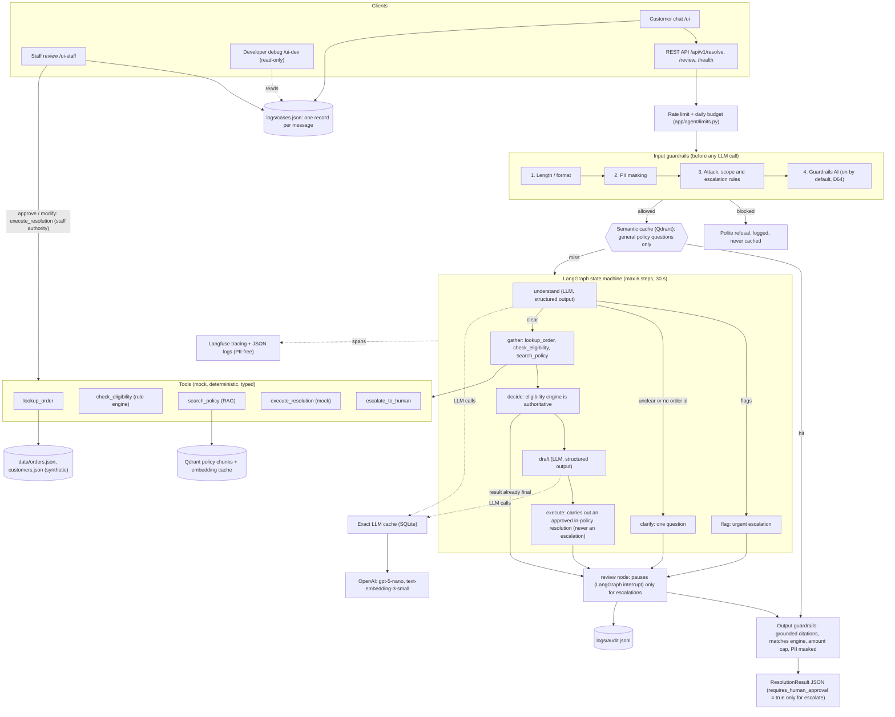
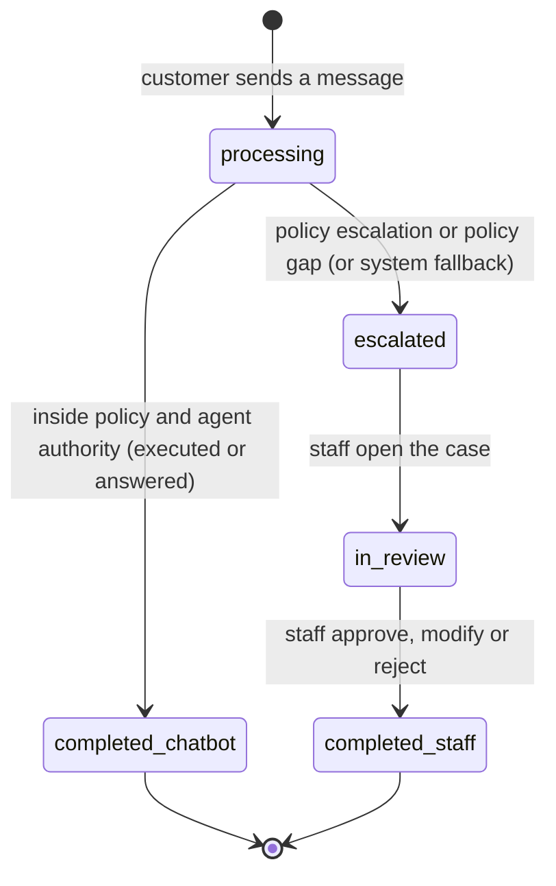

# Architecture

ResolveRight is a customer-support agent that acts within Brightcart policy (D50). It reads a customer's message, looks up the order, asks a deterministic rule engine what the policy allows, finds the policy text, drafts a reply, and then **carries out** the approved resolution (refund, store credit, replacement or cancellation up to the ₱5,000 agent limit) with the mock `execute_resolution` tool. Only a policy escalation (POL-10) or a policy gap goes to a person, with a structured hand-off payload, and an escalated case is never executed. Execution is a mock: a line in `logs/resolutions.jsonl` and a change in a runtime copy of the order (`logs/order_state.json`); the files in `data/` are never edited.

## Diagram

## How a request flows

1. **Entry.** The UI or a REST client sends a customer id, a session id and a message. `Agent.resolve` first rejects empty, long or unreadable input, then applies the per-customer rate limit and the daily budget.
2. **Input guardrails.** PII is masked, then attack, off-topic and escalation rules run. A blocked request never reaches the LLM or a tool. (The diagram groups the length check with the other input layers.)
3. **Understand.** The LLM turns the masked message into a structured intent, an order id and flags. It does not decide anything.
4. **Route.** Flags (safety, fraud) escalate at once. A missing order id or an unclear intent gets one clarifying question. Otherwise the graph gathers facts.
5. **Gather.** `lookup_order` checks the order exists and belongs to the customer. `check_eligibility` applies the policy rules to dates, amounts and status. `search_policy` retrieves the policy chunks to cite.
6. **Decide.** The rule engine result is the recommendation. The LLM cannot override it.
7. **Draft.** The LLM writes the customer reply and the internal summary from the decision and the retrieved text.
8. **Execute.** If the result is a refund, partial refund, store credit, replacement or cancellation that the rule engine approved inside agent authority, the `execute` node calls `execute_resolution`. The tool re-checks ownership and re-runs the rule engine itself, so the LLM cannot cause an action or amount the rules did not approve. It writes one ledger line and a runtime order change, refuses a repeat of the same request ("already processed"), and the customer reply gets a confirmation with the reference. An escalation, a flagged case (including a request for a human) or a result replaced by the output check is never executed. If the tool fails, the case is handed over as a system fallback.
9. **Review gate.** Only an escalation pauses the graph for a person (the rule engine escalates safety, fraud, legal, harassment, chargebacks, three refunds in 90 days, a request for a human, amounts above ₱5,000, late damage claims, risky address changes, and a question no policy covers, per POL-10). Every escalation carries a structured hand-off payload (customer id and first name, what was wanted, why it escalates, policies, urgency, facts found, `executed: false`), shown under Agent Process in the Developer Debug View. The escalation log keeps ids only, no name.
10. **Output guardrails.** Citations must be retrieved chunks, the recommendation must match the engine, the amount is capped at the engine maximum, and PII in the draft is masked. One repair attempt, then a safe escalation.

## Cases and the three pages (D51)

Every customer message becomes a case (`app/cases.py`, stored in `logs/cases.json`). One `status` field says where it is, so "completed" is visible and not implied.

| Status | Customer status (inline line, open-requests line, My requests) |
|---|---|
| `processing` | Processing |
| `completed`, `resolved_by = chatbot` | Completed - resolved by Brightcart Assistant |
| `escalated` | Escalated - waiting for staff |
| `in_review` | Staff is reviewing |
| `completed`, `resolved_by = staff` | Completed - resolved by staff |

- **Scenario 1 (chatbot completes).** `process_message` saves the case, runs the agent, executes the in-policy resolution (D50) and marks the case `completed` with the reference. Staff never see it.
- **Scenario 2 (escalated).** The case is saved as `escalated` with the hand-off payload and the debug block. The customer sees the escalation message and an amber badge. On `/ui-staff` a staff member opens it (`in_review`), reads the hand-off packet, transcript and the chatbot's recommendation, and decides. Approve and modify run `execute_resolution` with staff authority (ownership, repeat check and the remaining-refundable cap still apply); reject executes nothing. The case becomes `completed` (`resolved_by = staff`) and the staff reply reaches the customer chat on the next timer tick (once; `staff_reply_delivered`).
- **Developer page.** `/ui-dev` rebuilds the Agent Process, Pipeline, Tools, Retrieval, Guardrails and Raw sections from the saved `debug.result` of a case. It never writes.
- **Concurrency.** One lock and an atomic file swap (`os.replace`), so a page never reads a half-written file. One server process only. A second submit on a completed case is refused, so a double click cannot execute twice.
- **Fresh start every session (D53).** The server deletes `logs/cases.json`, `logs/order_state.json` and `logs/resolutions.jsonl` at start-up (`cases.reset_store()` and `orders.reset_runtime_state()` in the API lifespan, switch `RESET_CASES_ON_STARTUP`, D60), so the staff page never lists stale cases and no refund history carries over; a limitation, see `docs/limitations.md`.
- **No staff login** (a limitation, see `docs/limitations.md`): the staff page is open for the demo.

## Where each piece lives

| Concern | Code | Detail |
|---|---|---|
| API and UI | `app/api/main.py`, `app/ui/gradio_app.py` (customer), `app/ui/staff_ui.py`, `app/ui/dev_ui.py`, `app/ui/theme.py`, `app/server.py` | FastAPI with Gradio mounted at `/ui`, `/ui-staff` and `/ui-dev` |
| Cases | `app/cases.py`, `scripts/reset_state.py` | shared case file, staff decision, reset helper |
| State machine | `app/agent/graph.py` | nodes `understand`, `clarify`, `flag`, `gather`, `decide`, `draft`, `execute`, `review` |
| Memory | `app/agent/memory.py` | session history and case state, expires after 30 minutes |
| Tools | `app/tools/` | `orders`, `eligibility`, `policy_search`, `resolution`, `escalation`, `fault_injection`, `registry` |
| RAG | `app/rag/` | chunking, embeddings (cached), Qdrant ingest and retrievers |
| Caches | `app/cache/` | exact SQLite cache and semantic Qdrant cache (`docs/caching.md`) |
| Guardrails | `app/guardrails/` | input, output, PII, Guardrails AI (on by default, off on the Render free plan; `docs/guardrails.md`) |
| Observability | `app/observability/` | JSON logs with request ids, Langfuse tracing |
| Prompts | `prompts/` | `v1_baseline`, `v2_grounded`, `v3_checklist`, `v4_approval_aware` (after D47), `v5_executing` (default, after D50; not compared against v1 to v4), plus `understand` and `rag_answer` |

## Key decisions

The full list is in `docs/miscellaneous/design-decisions.md`. The ones a reader needs first:

- **The rule engine decides, the LLM talks.** Money decisions come from code that is tested for every order archetype. The LLM understands the message and writes wording.
- **A small explicit state machine** (LangGraph) with a step cap and a timeout, so a loop cannot cost money.
- **Two cache tiers with safety rules.** The semantic tier only serves general policy questions, so a near-identical message about a different order can never get another order's answer (CA-04).
- **The agent acts within policy, people take the rest (D50).** In-policy resolutions are executed (mock); only policy escalations and policy gaps go to a person. `requires_human_approval` is true exactly when the recommendation is `escalate` (D47). Evaluation numbers before 2026-10-30 predate execution.
- **Cases and three pages (D51).** One case record per message with a visible status; staff finish escalated cases on their own page; the developer view is its own read-only page.
