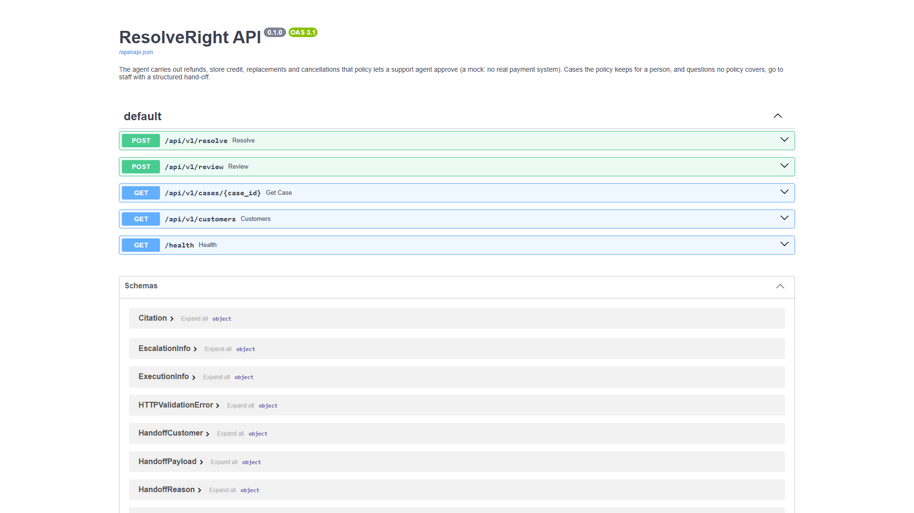

# API screenshots

| File | What it shows | Spec or guide item |
|---|---|---|
| `api-openapi.png` | The generated API documentation page (`/docs`) | Usable interface, API-02 |

Command-line proof that the API works: [`../../miscellaneous/api-curl.txt`](../../miscellaneous/api-curl.txt).

## Screenshots

### `api-openapi.png`

Look for: the generated list of API endpoints.

Back to the [evidence index](../../README.md).
