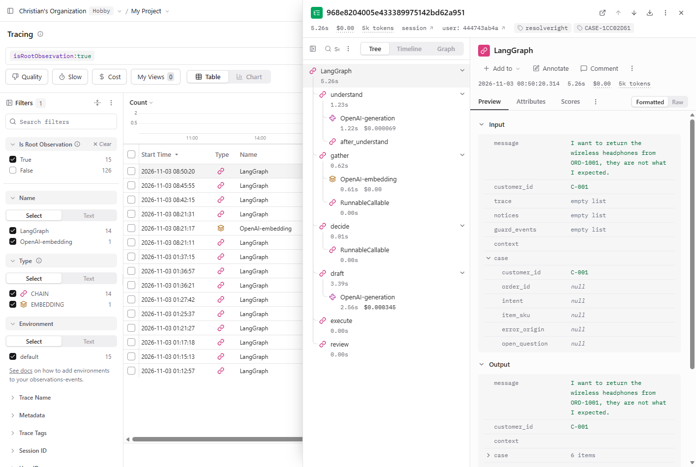
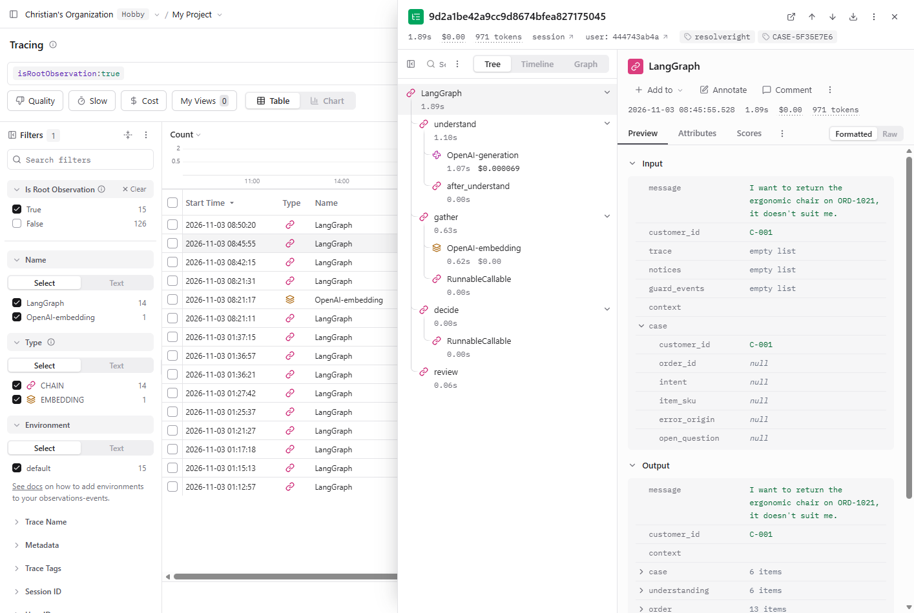
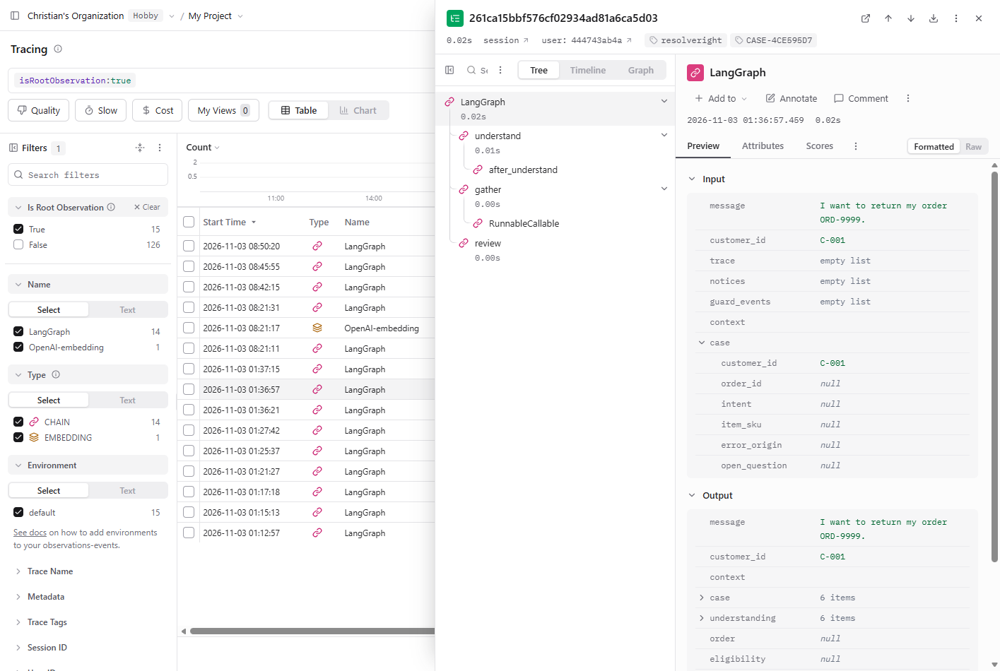

# Tracing screenshots (Langfuse)

Three traces of the live Render app (https://resolveright.onrender.com), taken in Langfuse. The account sidebar is cropped out so no account detail shows. Messages blocked by the input rules stop before the agent graph, so they have no trace; their evidence is [`../../guardrail-blocked-log.txt`](../../guardrail-blocked-log.txt).

| File | What it shows | Spec or guide item |
|---|---|---|
| `trace-retrieval.png` | A full refund flow: understand, gather (embedding retrieval), decide, draft, execute, review, with latency, tokens and cost | TR-01 to TR-04 |
| `trace-escalation.png` | ORD-1021 handed to staff | TR-01 to TR-04 |
| `trace-toolfailure.png` | Unknown order ORD-9999 handled without an LLM call | TR-01 to TR-04 |

Text check that Langfuse received the traces: [`../../langfuse-check.txt`](../../langfuse-check.txt).

## Screenshots

### `trace-retrieval.png`

Look for: the steps understand, gather, decide, draft, execute and review with latency, tokens and cost.

### `trace-escalation.png`

Look for: the trace of ORD-1021 ending in a hand-off to staff.

### `trace-toolfailure.png`

Look for: the trace of the unknown order ORD-9999, with no LLM call.

Back to the [evidence index](../../README.md).
