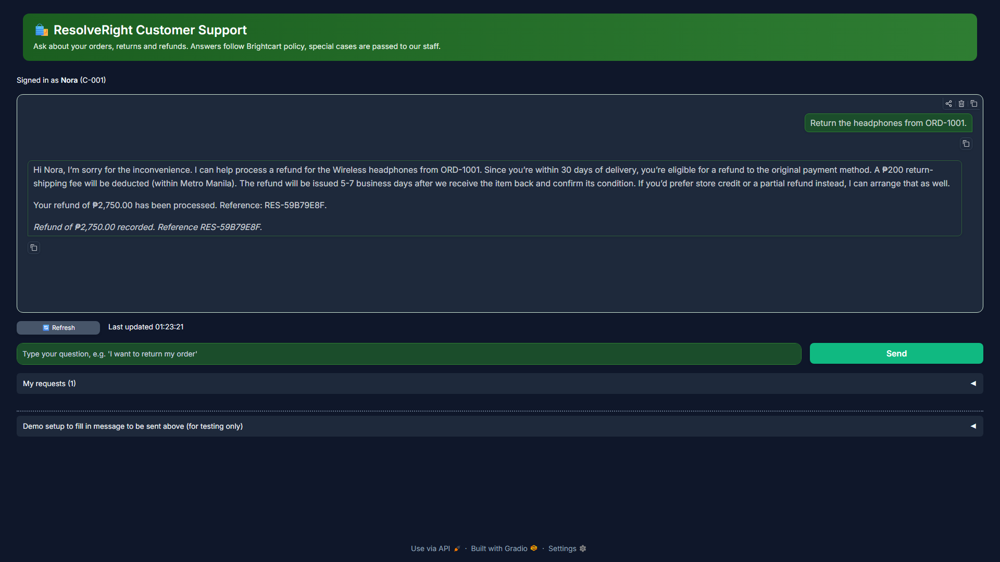
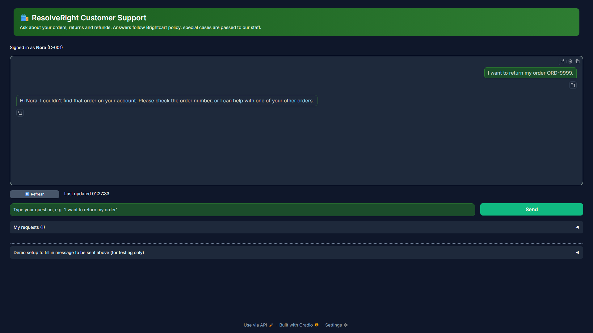
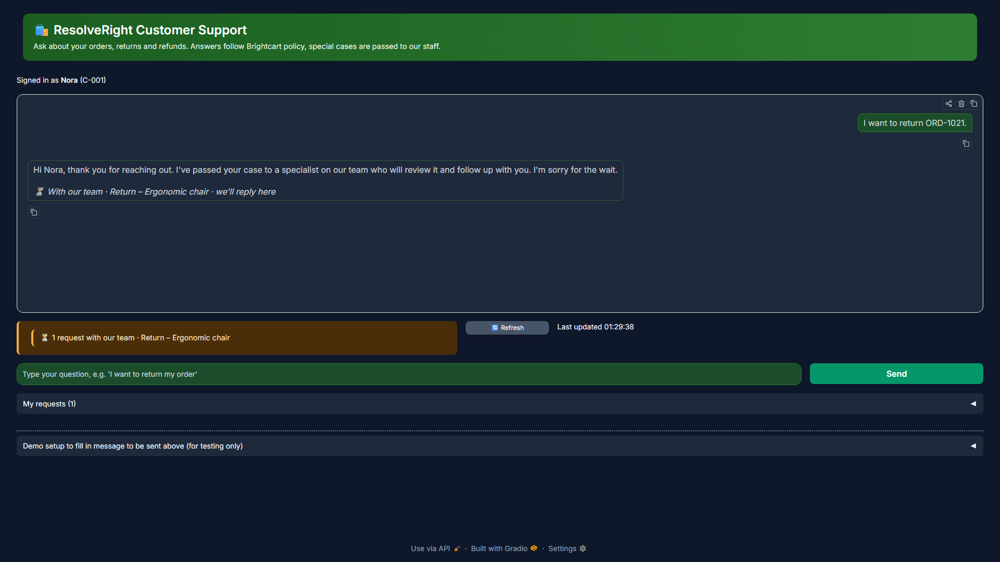
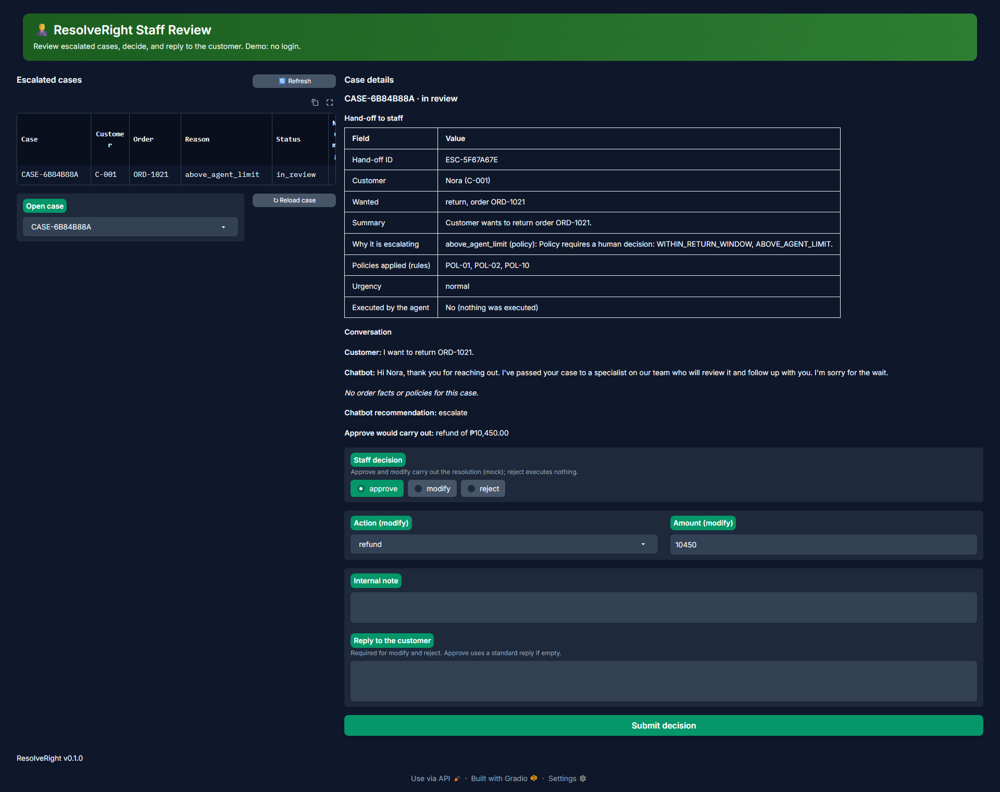
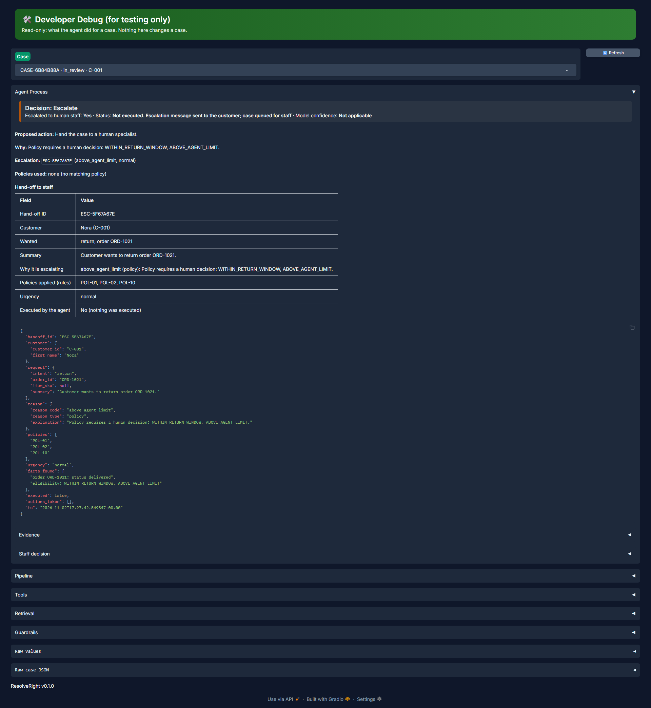

# UI screenshots

The customer chat page, the Staff Review page and the Developer Debug page of the app. Together they show the core refund flow, a polite failure, and the human-in-the-loop path for a case that policy keeps for a person.

| File | What it shows | Spec or guide item |
|---|---|---|
| `ui-core-flow.png` | A return request answered with the refund confirmation and reference | FT-01 |
| `ui-graceful-failure.png` | An unknown order handled politely: asks again, reveals nothing, executes nothing | GD |
| `ui-escalated.png` | A case passed to staff, as the customer sees it | AG (escalation) |
| `ui-staff-review.png` | Staff Review: hand-off packet, agent recommendation, staff decision | AG (human-in-the-loop) |
| `ui-dev-debug.png` | Developer Debug (read-only): steps, tools, retrieval and guardrails of the same case | AG |

## Screenshots

### `ui-core-flow.png`

Look for: the refund confirmation with a reference number after a return request.

### `ui-graceful-failure.png`

Look for: a polite reply to an unknown order, with no refund executed.

### `ui-escalated.png`

Look for: the message that the case was passed to staff.

### `ui-staff-review.png`

Look for: the hand-off packet, the recommendation and the staff decision form.

### `ui-dev-debug.png`

Look for: the read-only steps, tools, retrieval and guardrail results of the same case.

Back to the [evidence index](../../README.md).
